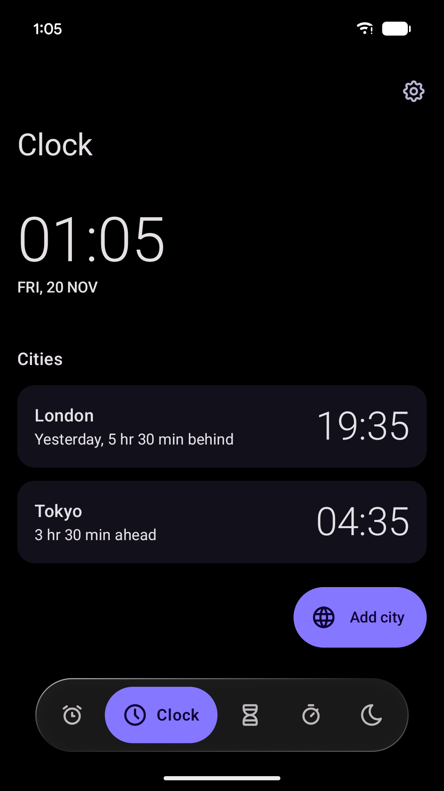
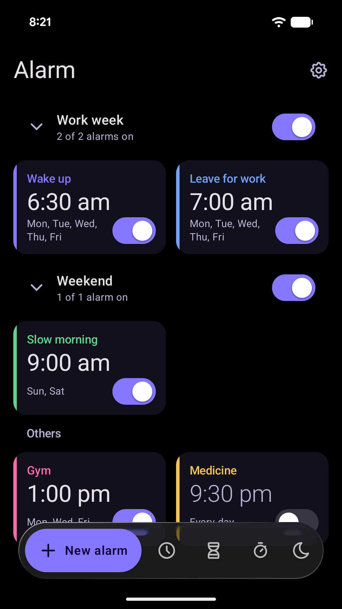
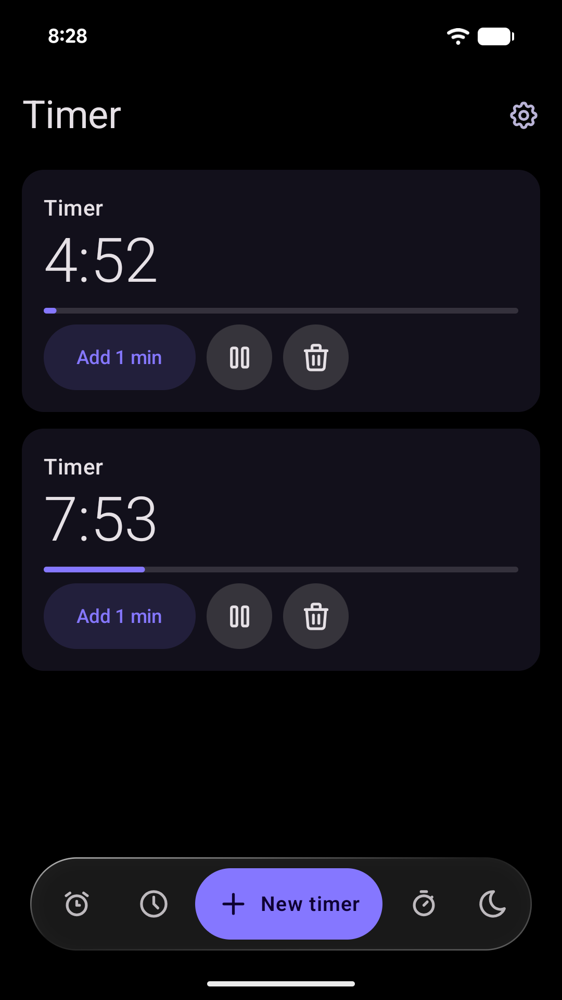
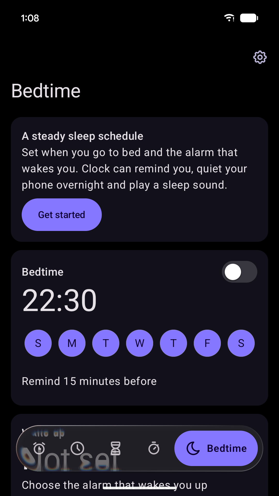

<!--
SPDX-FileCopyrightText: Saalim Quadri <danascape@gmail.com>
SPDX-License-Identifier: Apache-2.0
-->

# Clock


Alarms, timers, a stopwatch, world clocks and a bedtime routine. No ads, no tracking, no internet
permission.

<p align="center">
  
  
  
  
</p>

## Features

- Alarms that repeat on chosen days, ring once on a date, or pause for a holiday
- Labels, colours, your own sounds (a file or a recording) and vibration
- Named alarm groups you can collapse, and switch on or off together
- Slide up to dismiss and down to snooze, or tap; volume buttons, flip or shake work too
- Gradually increasing volume and a sunrise that brightens the screen before the alarm
- Dismiss an upcoming or snoozed alarm early, or turn off all alarms at once
- Warnings when battery or permission settings could keep alarms from ringing, and the reason an
  alarm was missed
- Several timers at once, with saved timers you name and one-tap extra minutes
- Stopwatch ring with laps, fastest and slowest highlighted, saved times and sharing
- World clocks for 340 cities or places of your own, sorted by name or time zone, with a home clock
  while you travel
- Bedtime dial with a sleep goal, reminder, wake-up alarm, Do Not Disturb at night, white, pink
  and brown noise, and tomorrow's first calendar event
- Screen saver with a night mode
- Widgets: analog clock with three faces, digital, stacked, stopwatch and timer
- Quick Settings tiles and live notifications for the timer and stopwatch
- Two panes on tablets, foldables and phones on their side
- Light and dark themes

## Download

<a href="https://apps.obtainium.imranr.dev/redirect?r=obtainium://add/https://github.com/PVOT-OSS/Clock"></a>
<a href="https://github.com/PVOT-OSS/Clock/releases"></a>

Requires Android 12 or newer.

## Privacy

No accounts, no ads, no analytics and no internet permission. Your alarms and settings stay on
your device. See the [Privacy Policy](PrivacyPolicy.md).

## Building

You need JDK 21 and the Android SDK (`ANDROID_HOME` set). The design system comes in as a git
submodule:

```sh
git clone --recurse-submodules https://github.com/PVOT-OSS/Clock
cd Clock
./gradlew assembleDebug
```

The APK is written to `app/build/outputs/apk/debug/`. Debug builds install alongside the release
as `org.prauga.clock.dev`.

## Contributing

Bug reports and pull requests are welcome on
[GitHub](https://github.com/PVOT-OSS/Clock/issues). When reporting a bug, include the steps to
reproduce it, the app version and your device and Android version.

Sign off your commits (`git commit -s`, [DCO](https://developercertificate.org/)). Every file
carries an SPDX header; CI runs [REUSE](https://reuse.software/) and
[pre-commit](https://pre-commit.com/) checks on each pull request.

## Credits

- Forked from LineageOS's [DeskClock](https://github.com/LineageOS/android_packages_apps_DeskClock),
  the Android Open Source Project clock.
- Built on [PvotLib](https://github.com/PVOT-OSS/PvotLib), the PVOT design system.
- [Tabler Icons](https://tabler.io/icons), MIT License.

## License

Copyright (c) The Android Open Source Project, The LineageOS Project and Saalim Quadri.

Licensed under the [Apache License 2.0](LICENSES/Apache-2.0.txt). Tabler Icons are under the
[MIT License](LICENSES/MIT.txt).
